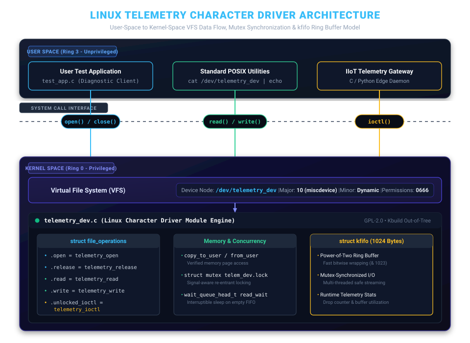

# Linux Telemetry Character Device Driver (`/dev/telemetry_dev`)

[](https://kernel.org)
[](https://en.wikipedia.org/wiki/C_(programming_language))
[](https://docs.kernel.org)
[](https://github.com/sherifred-singh/linux-telemetry-char-driver/actions/workflows/ci.yml)
[](LICENSE)

A virtual **Linux Character Device Driver** implemented as a dynamically registered kernel module (`miscdevice`). The driver bridges telemetry data streams between user space and kernel space using a mutex-synchronized circular FIFO buffer (`kfifo`), POSIX blocking/non-blocking wait queues, and a dedicated `ioctl()` application binary interface (ABI) for hardware control.

---

## 1. System Architecture & Data Flow

The driver creates a virtual device node at `/dev/telemetry_dev`, exposing standard POSIX Virtual File System (VFS) operations while enforcing rigorous user-kernel memory isolation:



### Architectural Layering
1. **User Space Applications:** Diagnostic clients (`test_app.c`), edge daemons, or standard UNIX utilities (`echo`, `cat`) interface with the node via standard system calls (`open`, `read`, `write`, `ioctl`, `close`).
2. **System Call Interface:** Enforces CPU privilege transition from unprivileged User Mode (Ring 3) to privileged Kernel Mode (Ring 0).
3. **Linux VFS & Miscdevice Layer:** Dispatches file descriptor operations to the driver's registered `struct file_operations` dispatch table.
4. **Driver Core Engine (`telemetry_dev.c`):**
   - **Data Path:** Manages kernel circular buffering via `struct kfifo` synchronized by `struct mutex` for multi-threaded safety.
   - **Control Path:** Decodes hardware commands and exposes telemetry statistics through `unlocked_ioctl`.
   - **Scheduling:** Suspends readers on an empty FIFO using `wait_queue_head_t` and wakes them upon write arrival.

---

## 2. Key Technical Capabilities

### A. Memory Boundary Isolation (`copy_to_user` / `copy_from_user`)
Directly dereferencing user-space pointers inside kernel code is a severe security vulnerability that can trigger kernel panics. The driver strictly routes all memory exchanges through architecture-optimized kernel copy helpers, validating virtual memory page mappings and immediately returning `-EFAULT` if user memory is unmapped:
```c
if (copy_to_user((void __user *)arg, &snapshot, sizeof(struct telemetry_stats)))
    return -EFAULT;
```

### B. Mutex-Synchronized Kernel Ring Buffering (`struct kfifo`)
The driver utilizes the Linux kernel's optimized `kfifo` subsystem protected by `struct mutex`:
- Allocated with a power-of-two capacity ($1024\,\text{bytes}$) to allow bitwise index wrapping (`mask = size - 1`).
- Wrapped with `mutex_lock_interruptible()` to ensure thread-safe multi-reader and multi-writer serialization.
- Tracks overflow telemetry drops when user burst rates exceed buffer capacity.

### C. Concurrency & Thread Safety (`struct mutex`)
All multi-threaded mutations, statistics snapshots, and IOCTL state transitions are serialized using `struct mutex` via `mutex_lock_interruptible()`, ensuring processes can safely receive OS signals (`Ctrl+C`) without deadlocking kernel workers.

### D. Blocking & Non-Blocking I/O (`wait_queue_head_t`)
- **Blocking Mode (Default):** When a reader requests data from an empty FIFO, it enters interruptible sleep (`wait_event_interruptible`) and yields the CPU. As soon as `write()` commits bytes, it triggers `wake_up_interruptible()`.
- **Non-Blocking Mode:** If opened with `O_NONBLOCK`, an empty FIFO immediately returns `-EAGAIN` without sleeping.

### E. Hardware Control ABI via IOCTL
Exposes an out-of-band control channel using Linux's `_IO`, `_IOR`, and `_IOW` macro suite (`Magic: 'T'`):
- `TELEMETRY_IOC_RESET`: Atomically flushes FIFO and clears counters.
- `TELEMETRY_IOC_GET_STATS`: Exports runtime throughput and FIFO utilization metrics.
- `TELEMETRY_IOC_SET_MODE`: Configures acquisition modes (`Normal`, `Burst`, `Diagnostic`).

---

## 3. Directory Layout

```
linux-telemetry-char-driver/
├── Makefile                       # Master kbuild compilation script
├── driver/
│   └── telemetry_dev.c            # Linux Kernel Module source (~150 LOC)
├── include/
│   └── telemetry_ioctl.h          # Shared IOCTL ABI definitions & structures
├── userspace_test/
│   └── test_app.c                 # C test client & validation suite
├── docs/
│   ├── architecture.svg           # Vector architecture & memory boundary diagram
│   ├── IOCTL_SPECIFICATION.md     # In-depth IOCTL ABI reference
│   ├── ARCHITECTURE_CONCEPTS.md   # Core OS & memory safety principles
│   ├── PROFILING_AND_TRACING.md   # Linux kernel ftrace & perf analysis guide
│   └── terminal_verification_log.txt # Raw execution log of hardware-in-the-loop tests
```

---

## 4. Build, Load & Verification Guide

### Prerequisites
On Ubuntu / Debian / WSL2:
```bash
sudo apt-get update
sudo apt-get install build-essential linux-headers-$(uname -r)
```

### Step 1: Compile the Driver and Test Tool
```bash
make
```
*Outputs: `telemetry_dev.ko` (Kernel Module) and `test_app` (User Space Test Client).*

### Step 2: Insert the Kernel Module
```bash
sudo insmod telemetry_dev.ko
```
Verify registration in kernel logs:
```bash
dmesg | tail -n 5
```
Expected output:
```text
[ 4125.102341] telemetry_dev: Initializing Industrial Telemetry Driver...
[ 4125.102348] telemetry_dev: Driver successfully registered! Node created at /dev/telemetry_dev
[ 4125.102350] telemetry_dev: kfifo initialized with 1024 bytes capacity
```

### Step 3: Verify the Device Node
```bash
ls -l /dev/telemetry_dev
```
```text
crw-rw-rw- 1 root root 10, 124 Oct  5 12:21 /dev/telemetry_dev
```

### Step 4: Run the Automated Verification Suite
```bash
sudo ./test_app
```

Expected test run output:
```text
==============================================================
  LINUX TELEMETRY DRIVER TEST & VERIFICATION SUITE (/dev/telemetry_dev)
==============================================================

[TEST 1] Opening character device node: /dev/telemetry_dev ... [PASSED] (fd = 3)

[TEST 2] Querying initial driver statistics via IOCTL ... [PASSED]
---------------- CURRENT DRIVER STATISTICS ----------------
  • Total Bytes Written : 0 bytes
  • Total Bytes Read    : 0 bytes
  • FIFO Utilization    : 0 / 1024 bytes (0.0%)
  • Dropped Bytes       : 0 bytes
  • Acquisition Mode    : NORMAL (0)
-----------------------------------------------------------

[TEST 3] Writing 16-byte telemetry frame to kernel buffer ... [PASSED] (16 bytes written)
[TEST 4] Reading telemetry frame back from kernel buffer ... [PASSED] (16 bytes read)
  Payload verification: Data Integrity 100% Matched!
  Hex dump: AA 55 01 21 0A 01 02 03 04 05 06 07 08 38 50 

[TEST 5] Setting acquisition mode to BURST (1) via IOCTL ... [PASSED]
[TEST 6] Triggering FIFO Reset via IOCTL ... [PASSED]
[TEST 7] Testing invalid IOCTL command rejection ... [PASSED] (Kernel safely returned ENOTTY: Inappropriate ioctl)

==============================================================
  ALL 7 TESTS COMPLETED SUCCESSFULLY! DRIVER OPERATIONAL.
==============================================================
```

### Step 5: Unload the Module
```bash
sudo rmmod telemetry_dev
dmesg | tail -n 2
```
```text
[ 4140.551204] telemetry_dev: Unloading Industrial Telemetry Driver...
[ 4140.551210] telemetry_dev: Clean teardown complete. Device /dev/telemetry_dev removed
```

---

## 5. Architectural Decisions & Design Trade-offs

### A. miscdevice Framework vs. Manual alloc_chrdev_region()
Traditional character device registration requires allocating major and minor device numbers via `alloc_chrdev_region()`, instantiating a `cdev` structure, and creating a `sysfs` device class (`class_create()` / `device_create()`) to populate the node under `/dev/`. For single-instance character drivers, the Linux kernel provides the `miscdevice` subsystem (Major number 10). It automates dynamic minor allocation and creates `/dev/telemetry_dev` in a single call (`misc_register()`), reducing kernel boilerplate while retaining full `file_operations` dispatch flexibility.

### B. Safe Memory Boundary Enforcement (copy_to_user / copy_from_user)
Kernel code must never dereference user-supplied pointers directly (`*ptr`). Doing so bypasses CPU memory page table validation and risks arbitrary kernel memory corruption or fatal page faults. This driver routes all data transfers through `copy_to_user()`, `copy_from_user()`, and the `kfifo_*_user()` helper suite. These routines validate memory page boundaries and leverage the kernel Exception Table (`extable`) to catch access violations cleanly, returning `-EFAULT` without triggering a kernel panic.

### C. Process Scheduling & Wait Queue Sleep Semantics
When a consumer process calls `read()` on an empty FIFO, it enters interruptible sleep (`TASK_INTERRUPTIBLE`) via `wait_event_interruptible()` and yields the CPU. When a producer calls `write()`, it invokes `wake_up_interruptible()`, moving the sleeping task back to `TASK_RUNNING`. If an external POSIX signal (such as `SIGINT` from Ctrl+C) arrives during sleep, the call returns `-ERESTARTSYS` immediately, ensuring processes remain responsive to termination signals without hanging kernel worker threads.

### D. Kernel Ring Buffer Primitives (kfifo vs. Custom Arrays)
Custom circular array implementations in multi-core SMP environments often introduce subtle memory ordering bugs requiring explicit memory barriers (`smp_mb()`). Linux's `struct kfifo` provides a thoroughly validated primitive with power-of-two capacity sizing, allowing pointer wrapping via bitwise masking (`& (size - 1)`) rather than modulo division. In this driver, `kfifo` is further guarded by `struct mutex` to guarantee thread safety across multi-threaded userspace clients.

---

## 6. Project Contributors & Collaboration

| Contributor | Role | Profile / Repository |
| :--- | :--- | :--- |
| **Sherifred Singh** | Primary Author & Driver Architect | [@sherifred-singh](https://github.com/sherifred-singh) |
| **Jenief** | Project Collaborator & Peer Research Partner | [@Jenief](https://github.com/Jenief) • [Linux_Learning](https://github.com/Jenief/Linux_Learning) |

### Community References & Inspiration
* **Linux Kernel Documentation:** Official kernel guides on [`miscdevice`](https://docs.kernel.org/driver-api/misc_devices.html), [`kfifo`](https://docs.kernel.org/core-api/kfifo.html), and [wait queues](https://docs.kernel.org/driver-api/basics.html).
* **Peer Learning & Research:** Special acknowledgment to [Jenief](https://github.com/Jenief) and the [Jenief/Linux_Learning](https://github.com/Jenief/Linux_Learning) repository for peer collaboration, Linux driver discussions, and hands-on kernel module experimentation (including USB sub-drivers and hot-plug URB mechanisms).

---

## 7. License
This project is licensed under the **GNU General Public License v2.0** (`GPL-2.0`).
